# cubing-trainer

Speedsolving trainer for all WCA events. This README is the source of truth for the technical tables, the architecture, and the diagrams.

## Overview

cubing-trainer trains algorithms across all WCA events through flashcards with spaced repetition, auto-animates any algorithm on a 3D cube, and auto-generates 3-style commutator algorithms with structural classification, constrained to a preferred move subset and scored for fingertrick friendliness, including full floating-buffer mode.

The stack is raylib 6, C23, and SQLite, built with clang 23 targeting mingw-w64 over the winlibs sysroot, driven by GNU make.

The 3-style generator is the distinguishing feature. It emits commutators labeled by structure (setup, interchange, insertion, pure, A9, B9, and the rest of the BH taxonomy), searches under a preferred move subset that defaults to R, U, D, and runs in fixed-buffer or floating-buffer mode.

## Build and make targets

Prerequisites, verified on this machine 2026-10-09: LLVM clang 23.1.3, winlibs UCRT gcc 16.2.0 as the mingw-w64 sysroot, GNU make 4.4.1, cmake, ninja, sqlite3 CLI 3.53.4, python 3 for the vendor, db-verify, and visual targets, and node with npx and mmdc (mermaid-cli). No MSYS2, no pkg-config.

Run `make vendor` first. It HEAD-checks each URL, downloads, extracts the pinned third party sources under third_party/, and verifies every archive by SHA3-256 through tools/vendor_verify.py: the raylib 6.0 and raygui 5.0 tag tarballs and the SQLite 3.53.4 amalgamation zip. Each stamp recipe verifies before extracting and the vendor target re-verifies the kept archives in build/vendor on every run, so a corrupted or truncated download fails the target and needs build/vendor removed to re-download. The zip extracts through python's zipfile module instead of tar because GNU tar on the make shell cannot read zip while the Windows bsdtar can, which made the old tar line depend on which tar won PATH order. raylib compiles from the flat third_party/raylib/src/*.c set of 7 TUs with -DPLATFORM_DESKTOP, a recursive glob over-collects platform files and breaks on duplicate symbols. raygui 5.0 ships only raygui.h, so the Makefile generates build/raygui_impl.c holding RAYGUI_IMPLEMENTATION plus the include as its single TU. sqlite3.c compiles with -Wno-error for two unused parameters in its Windows VFS code.

The toolchain spelling is decided, evidence in playground/spike_link/REPORT.md. Compile lines carry `--target=x86_64-w64-mingw32` alone and link lines add `-fuse-ld=lld`, which resolves crt2.o, crtbegin.o, and the gcc 16.2.0 library directories from the winlibs install. The `--gcc-install-dir` spelling is inert on clang 23.1.3, fails under -Werror as an unused argument, and is not used. One environment hazard: this account exports C_INCLUDE_PATH and CPLUS_INCLUDE_PATH at a foreign gcc, so the Makefile clobbers both to empty for every recipe. The link set for anything touching raylib is -static-libgcc -lopengl32 -lgdi32 -lwinmm, and those Windows libraries appear on no other link line.

| target | what it does |
| --- | --- |
| vendor | download, HEAD-check, SHA3-256 verify, and extract raylib 6.0, raygui 5.0, and the sqlite amalgamation into third_party/, re-verifying the kept archives every run |
| vendor-verify-selftest | exercise the archive hash checker against synthetic matches, corruptions, and malformed hashes |
| build | compile app, raylib, raygui, and sqlite sources and emit build/bin/cubing-trainer.exe |
| build-headless | compile tools/render_scene.c against the full library set and emit build/bin/render_scene.exe |
| spike | build and run the M0 toolchain spike from playground/spike_link |
| test | run the full unit suite |
| test-\<suite\> | run suites whose name matches the filter |
| fmt | format the tree |
| fmt-check | check formatting without writing |
| lint | clang-tidy plus the -Wall -Wextra -Werror -Wpedantic -std=c23 gate plus zero-comment and stray-constant checks |
| analyze | run clang --analyze over the sources |
| fuzz | run the 17 in-process fuzz suites, CT_FUZZ_LOOPS multiplies the iteration count |
| fuzz-\<suite\> | run one fuzz suite |
| mutate | run the token mutation harness over the SCOPE directory or file with the optional SUITE filter |
| e2e | run every tests/e2e/*.txt through cubing-trainer.exe --headless --script |
| visual | render the 4 golden scenes fresh into build/visual and compare against tests/golden through tools/run_visual.py and tools/visual_check.py |
| screenshots | seed a fresh CT_DATA_DIR sandbox and capture every feature point into docs/img/screens at fixed 1280x720 |
| db-verify | build a migrated DB through tools/make_db.c, then check integrity, user_version, and 42 schema assertions through the sqlite3 CLI |
| diagrams | render every docs/diagrams/*.mmd to PNG through tools/gen_diagrams.mjs |
| memguard | run tools/memguard.ps1 to enforce the combined working set cap on project processes |
| memguard-selftest | verify memguard process matching against a spawned sleeper exe |
| run | build then launch the trainer window |
| release | assemble build/release/cubing-trainer, zip it as build/cubing-trainer-\<git-describe\>.zip, and verify layout, zip bytes, a headless run, and fatal exits through tools/release_verify.py |
| release-verify-selftest | exercise the release verifier's layout, zip, and database assertions against synthetic trees |
| clean | remove build outputs |

make build-headless emits build/bin/render_scene.exe, the headless scene renderer that make visual drives. make e2e drives the real app binary the same way: each tests/e2e/*.txt case runs cubing-trainer.exe --headless --script with CT_DATA_DIR pointed at a fresh build/e2e/<case> sandbox, so no case ever touches the real %LOCALAPPDATA% database, and any nonzero case exit fails the target.

make release packages the trainer as build/cubing-trainer-\<git-describe\>.zip holding one cubing-trainer folder with dist/bin/cubing-trainer.exe plus db/migrations and db/seeds/packs. The exe resolves both resource trees exactly two directories up from its own location through the CT_MIGRATIONS_EXE_REL and CT_SEEDS_PACKS_EXE_REL defaults in the config hub, so it sits under dist/bin, the same two-level shape as build/bin inside the repo, and any shallower or deeper placement breaks both resolutions. tools/release_verify.py compares the packaged file sets against the repo trees, compares every zip entry byte for byte, runs the packaged exe headless from a foreign working directory against a fresh LOCALAPPDATA and asserts the database migrates to the latest user_version and event_pack holds all 714 seed rows, then asserts the two fatal paths, LOCALAPPDATA unset and a missing migrations directory, both exit 1 with their startup errors.

make visual locks against concurrent runs through build/visual.lock and, for the animated mid scene, renders twice per gate and requires the pair to self-agree before comparing against the committed golden, retrying once on disagreement. Persistent pair disagreement exits 3 as an infra flake, self-agreement that mismatches the golden exits 2 as a regression signal with evidence copied under build/visual_evidence. This split exists because golden_mid_3 flips between two byte-stable rasterization outputs on this machine on a minutes timescale, independent of source and binary, while the static scenes never flip; the phenomenon, proof, and drifted sample are recorded in tests/golden/PROVENANCE.md and playground/m7_visual/.

make screenshots drives the real exe end to end: it rebuilds cubing-trainer.exe, seeds a throwaway data directory under build/shots through playground/screens/seed.txt, then runs playground/screens/shots.txt against the same directory. Each shot command opens a hidden 1280x720 window, walks the real ct_ui_update and ct_ui_draw path into the target screen state, renders offscreen through LoadRenderTexture, and exports the PNG into docs/img/screens. Two consecutive runs over the same day produce byte-identical SHA-256 hashes for all 11 images, proven per run pair, while the stats session rows and the seeded review history embed real dates, so a corpus regenerated on a later date differs exactly there.

## Usage

`make run` opens the trainer windowed at the config default 1280x720. First start migrates the database, merges settings, and seeds every registered pack, so all screens have content before any configuration. The screenshots below are the real app in that seeded state, one per feature point.

### Menu

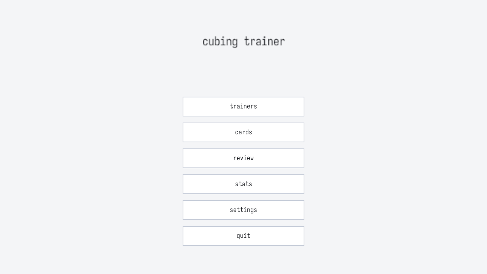

Five buttons plus quit: trainers, cards, review, stats, and settings. Number keys 1 to 5 jump straight to a screen, clicking works the same, and escape returns to the menu from any screen, or quits from the menu itself.

### Trainer selector

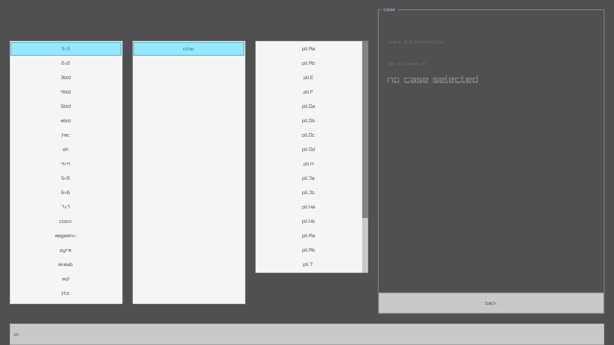

Three cascading lists walk event, then method, then list, one list per event, method, and stage triple registered in the packs. Curated lists read case keys from their seed rows, CFOP lists from the PLL, OLL, and F2L tables, and 3-style concept lists from the letter chart. The right pane names the current selection, counts its cases, and breaks the count down by group when a list carries several stages. Back and escape return to the menu.

### Letter chart

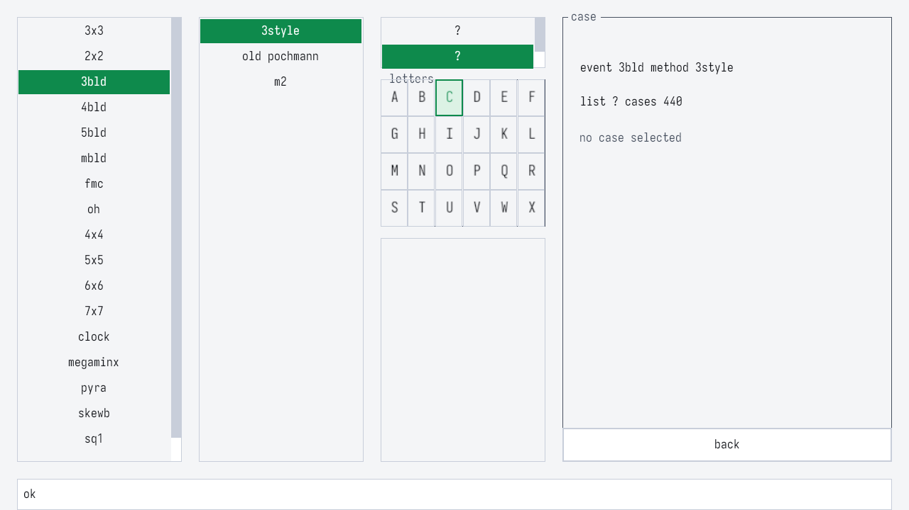

Selecting a 3-style list swaps the third column for the 24-letter chart of that orbit, laid out face by face. The buffer sticker renders blue, the picked cell yellow, and clicking the yellow cell clears the pick. The case list under the grid fills with the target pairs for the picked sticker.

### 3-style case view

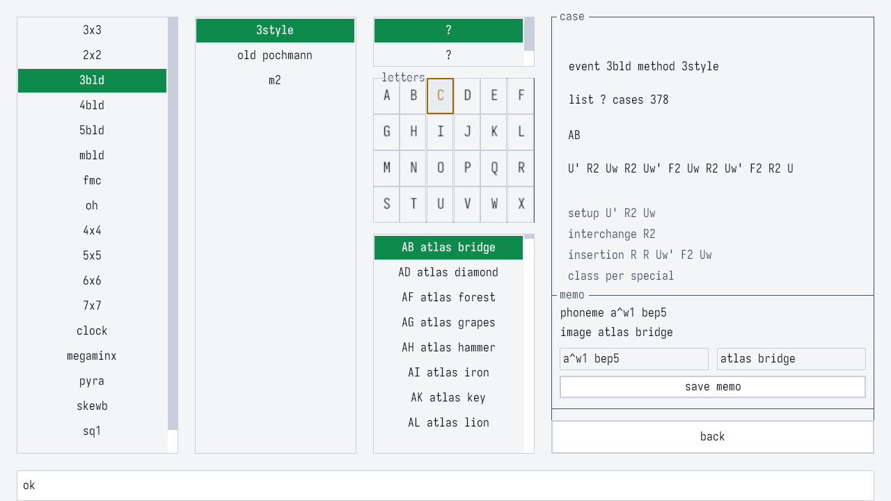

Picking a case shows the case front, the stored or generated algorithm, and the structural decomposition under the alg: the setup, interchange, and insertion spans plus the BH class label, the same decomposition ct_classify_alg emits. Generation and saving run through the script runner today, trainer_generate synthesizes and caches the case and trainer_save turns it into a reviewable flashcard.

### Review

Before reveal the card shows only the cube state and the word hidden, so the move count and the alg stay undisclosed, and the reveal button is the interactive trigger:

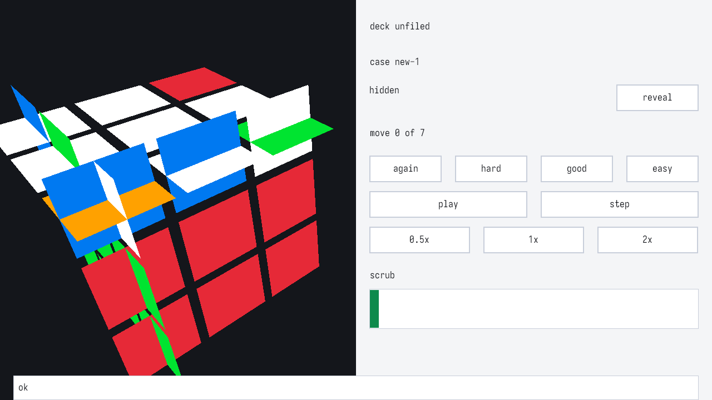

After reveal the alg text appears with playback controls: play and pause toggle, step advances one move, the 0.5x, 1x, and 2x buttons set the animation speed, and the scrub slider jumps to any move. The cube animates the algorithm through the same renderer the windowed app uses. Grading with again, hard, good, or easy applies the FSRS update and advances to the next due card, and the session log records the run.

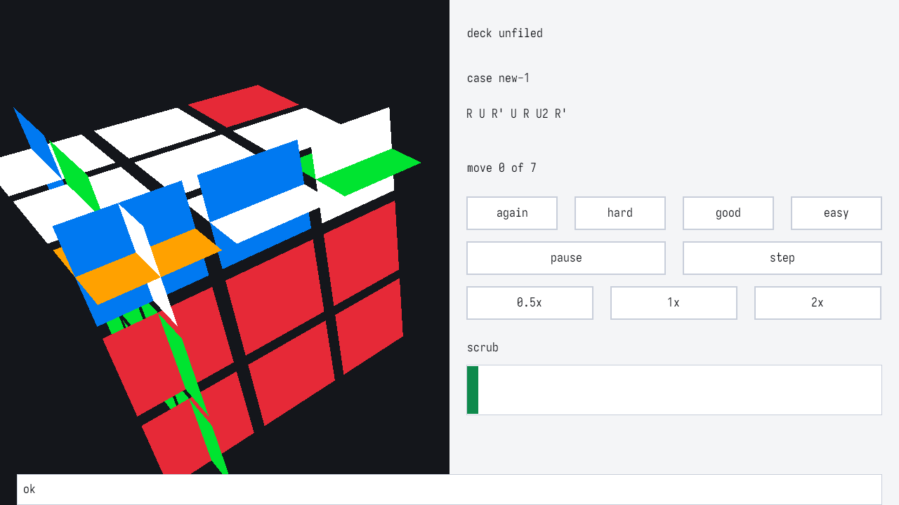

### Cards

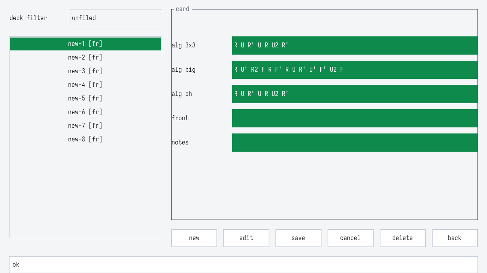

The cards screen is the CRUD surface for flashcards. The deck filter narrows the list, new opens a fresh card, edit stages the selected card, and save and cancel commit or drop the staged form. Every card carries the variant fields alg 3x3, alg big, and alg oh plus front and notes, so one case serves the 3x3, big cube, and one-handed events. A card enters the review queue when its first due date arrives.

### Settings

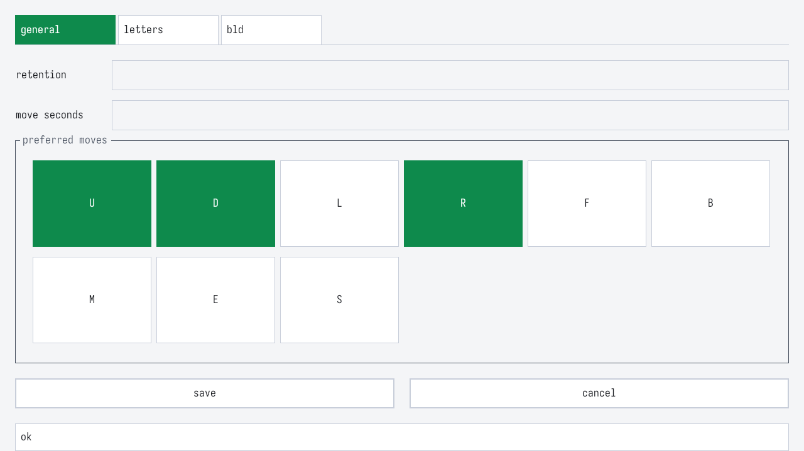

Three tabs stage every preference. General edits the requested retention and the animation seconds and toggles the preferred move subset per face letter, the subset the generator searches under.

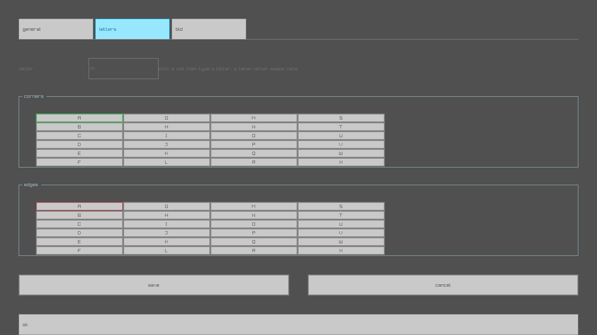

Letters edits the stored letter scheme per sticker: pick a sticker in the corner or edge grid, type a letter, and the sticker that held that letter swaps with it, while duplicate letters and letters outside A to X are rejected at staging.

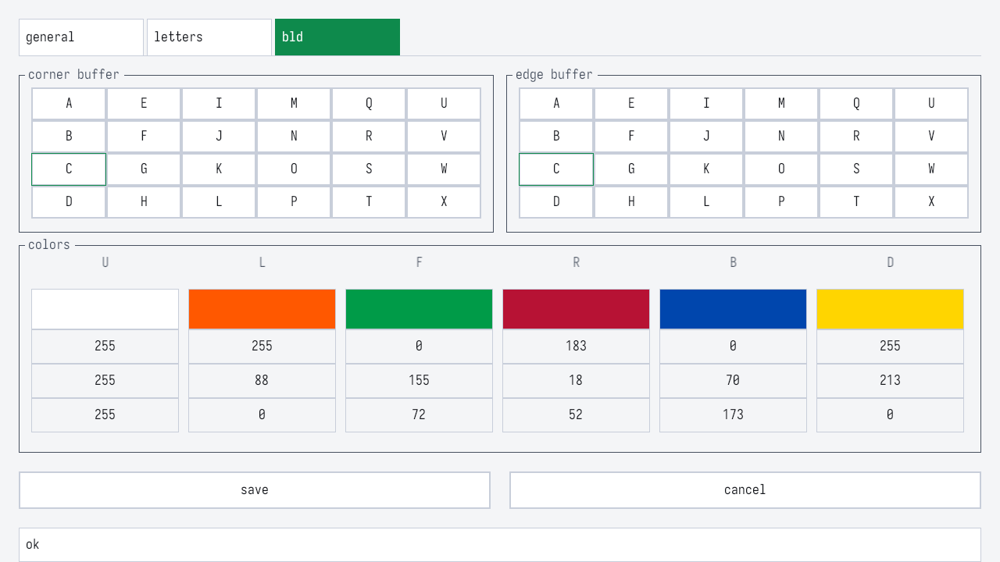

Bld picks the corner and edge buffer stickers from the same grids and edits the face color scheme through live swatches with an RGB value box per channel. Save writes through the same dotted-key parser as ct_config_set, rows the parser rejects are counted and surfaced instead of dropped, and the app config re-merges on every save.

### Stats

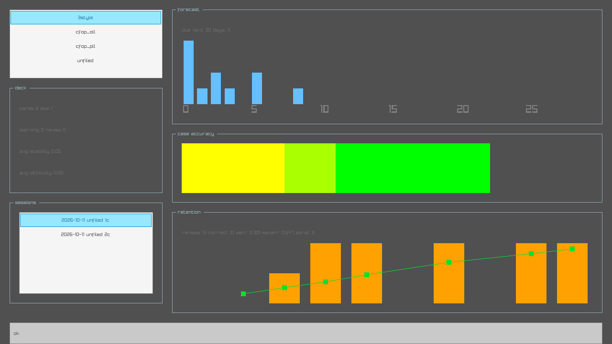

Stats aggregates the review history: the deck list selects a deck, the summary shows card and due counts with learning and review splits plus average stability and difficulty, the session list records past runs, the forecast bars count due cards over the next 30 days, the case accuracy heatmap colors every case by its hit rate with the row readable on hover, and the retention panel bars the actual recall per elapsed bucket with the predicted recall drawn as a marker line over them.

## Architecture

Module tree:

```
Makefile README.md
db/migrations/001_init.sql  db/seeds/speffz.sql  db/seeds/speffz_source.md  db/seeds/packs/*.tsv (16 seed packs)  db/seeds/packs/PROVENANCE.md
docs/diagrams/*.mmd  docs/diagrams/*.png (generated)  docs/img/screens/*.png (feature screenshots)  docs/reviews/*.md
src/config/config.h config.c
src/engine/cube.h cube.c notation.h notation.c transform.h transform.c geometry.h geometry.c geometry_sq1.h geometry_sq1.c geometry_clock.h geometry_clock.c
src/render/renderer.h renderer.c anim.h anim.c
src/ui/ui.h widgets.h widgets.c screen_menu.c screen_trainer.c screen_cards.c screen_review.c screen_settings.c screen_stats.c
src/storage/db.h db.c migrate.c repo_cards.c repo_reviews.c repo_settings.c repo_stats.c repo_algs.c
src/srs/fsrs.h fsrs.c
src/trainer/session.h session.c cfop.h cfop.c selector.h selector.c
src/gen/targets.h targets.c interchange.h interchange.c synth.h synth.c score.h score.c classify.h classify.c
src/stats/stats.h stats.c
src/packs/packs.h packs.c provenance.h provenance.c seed_registry.h seed_registry.c
src/app/main.c app.h app_loop.c headless.h headless.c paths.h paths.c script.h script.c script_expect.c script_internal.h script_shots.c shots.h shots.c
tools/gen_diagrams.mjs run_lint.ps1 run_analyze.ps1 check_zero_comments.ps1 check_stray_constants.ps1 stray_constants_allow.txt memguard.ps1 memguard_sleeper.c mutate.c make_db.c db_schema_check.sql db_verify.py render_scene.c run_visual.py visual_check.py visual_selftest.py
tests/framework.h framework.c test_main.c unit_*.c fuzz_engine.c fuzz_srs.c fuzz_db.c fuzz_config.c fuzz_main.c fixtures/ golden/ mutant_allowlist.txt
```

Landed since the last sync: the fix wave off the M2 to M5 adversarial review, all 12 defects and every note but the recorded A-O5 closed per docs/reviews/2026-10-10-adversarial-m2m5.md, the trainer selector screen with stored scheme routing (18f7a9f), the fsrs-5 state machine (bea663a), the storage boundary and params hash cluster (768e24d, d0c6fde, 34b9a73, e7b0f4e), the scored generator selection under the config candidate cap (292ae14), the 5x5 to 7x7 reduction seed packs (d957e6a), and the e2e runner grown to 6 cases over the real exe. Then the M6 wave: the 3-style generator with the params-hash cache and the fixed-buffer chart repinned to corner UFR plus edge UF defaults carrying 85 seeded 3BLD specials, the registry at 23 entries and 714 rows, the adversarial wave 6 fix set (canonical overflow fail-closed 7132d00, trainer stale form reload a190f10, script chart category 1d03915, case group labels 3c82103, letter range rejects 1662692) per docs/reviews/2026-10-11-adversarial-wave6.md, the blddb reference grounding under playground/ref_ground with the optimality comparison under playground/ref_compare, and the mutation gate campaign closed over all 26 production source files at 0 unexplained survivors with the allowlist capacity raised to 2048 (4289f15).

Layering, enforced by review: config depends on nothing. engine, srs, and storage depend on config. gen and render depend on engine. trainer depends on storage and srs. ui depends on trainer, render, and storage. app depends on ui. No upward or lateral edges.

Two patterns keep the code testable without a window. UI screens split a pure model from a thin draw layer: ct_cards_form and ct_settings_form in src/ui/ui.h carry form state and staged mutations with no raylib types, covered by tests/unit_cards_form.c, tests/unit_review_form.c, and tests/unit_settings_form.c, while the screen update and draw functions only translate app state into calls. The renderer splits the same way, ct_renderer_quads emits the sticker quad list as plain data and ct_renderer_draw is the only function that builds raylib meshes. ct_renderer_draw takes the animation duration as move_seconds (40c5a86): the headless golden path pins CT_RENDERER_MOVE_MILLIS from the config hub for deterministic output, while the review screen feeds the user's anim.move_seconds setting through ct_anim_update into the same draw call end to end.

raylib 6 notes from the renderer work: matrix types and math live in raymath.h and the mesh buffer layout lives in rlgl.h, whose stream order renderer.h records as position 0 and color 3. The draw path fills mesh.vertices and mesh.colors and hands them to UploadMesh, then UnloadMesh frees the CPU-side arrays along with the GPU upload, so the dynamic cube mesh is rebuilt and re-uploaded every frame, which stays cheap at 6 * n * n quads and keeps animation out of GPU lifetime management. LoadMaterialDefault is the unlit vertex color path, which is what flat sticker quads need.

The config hub is one header, src/config/config.h, holding ct_config, every enum (grade, orbit, buffer_mode, classification, event, method, stage, direction, ui_screen, ease, config status), and every tunable with its default: FSRS weights, requested retention, interval clamps, preferred move subset and per-face penalties, regrip and fingertrick weights, animation durations and easing, window defaults, DB filename, generator search bounds, and fuzz iteration counts. Face letters map to single bit flags through ct_move_face, CT_MOVE_BIT_U through CT_MOVE_BIT_Z covering faces, slices, and rotations, so a preferred subset is one unsigned mask and per-face penalties index by bit position. The hub is loaded once at startup through ct_config_defaults and passed by pointer, and user settings merge over the defaults through ct_config_set, which parses dotted setting names like srs.request_retention, gen.preferred_moves, and gen.penalty_R with range clamps and rejects unknown names. The settings screen stages edits and saves them through the same parser, rows the parser rejects are counted and surfaced on save instead of dropped, and the app config is re-merged on every save. Color scheme keys are the one surface outside the hub: the renderer owns the ui.color_* key list and applies saved values through the draw path, with the merge into ct_config recorded as future work once the header freeze lifts. The lint target fails on numeric literals in src/ outside config.h, inline test tables are exempt, and values that recur across test tables get centralized too.

Path resolution landed in src/app/paths.c (de06402). The data directory is %LOCALAPPDATA%/cubing-trainer, read from the environment at runtime and created with mkdir semantics when missing, and an unset LOCALAPPDATA or uncreatable directory aborts startup instead of running db-less (79ffeb5). The CT_DATA_DIR environment override takes precedence over LOCALAPPDATA and is how make e2e sandboxes each case. The migrations directory comes from the CT_MIGRATIONS_DIR environment override when set, else from the executable location at ../../db/migrations, so the installed exe finds the schema next to itself regardless of the working directory. Event pack seeds resolve the same way at ../../db/seeds/packs (CT_SEEDS_PACKS_EXE_REL, f0e8db9), and an override path too long for the buffer is reported at startup instead of being silently truncated (5291338).

## Cube engine

World axes are x right, y up, z front. Each of the 6 faces carries a (normal, row, col) frame in src/engine/cube.c, and a sticker center is normal * (n-1) plus row and col offsets where grid position i maps to the coordinate 2*i - (n-1), so centers lie on the integer range -(n-1) to n-1 with stride 2 and geometry, moves, and letters share one addressing scheme. A move selects its slab by the dot product of the sticker center with the face normal against the depth range, then rotates centers and normals by steps = -sign * quarter right hand quarter turns about the face axis, where sign is the normal's sign on that axis.

Sticker indexing for BLD work runs 0 to 23 per orbit: face order U L F R B D, corner sticker index is face * 4 + p with p running clockwise from (0, 0), edge sticker index is face * 4 + p with p running clockwise from the (0, 1) edge.

src/engine/transform.c rewrites move sequences as algebra: inverse, mirror, rotate_y, conjugate, and simplify. Mirror swaps R and L and inverts quarter counts, rotate_y cycles the side faces around U for k = 1, 2, 3. Simplify greedily folds adjacent moves that share a face and depth span, merging quarter counts modulo 4 and dropping zeros. Its cap bounds the returned sequence: the call fails only when the folded result exceeds cap or the input exceeds CT_TRANSFORM_ASSEMBLY_MAX, the assembly buffer that bounds intermediate work, and out is left untouched on failure. Both mirror and rotate_y carry simulation oracles in tests/unit_transform.c: mirroring the cube state after an algorithm equals applying the mirrored algorithm to the mirrored solved cube, and appending a y rotation to an algorithm equals applying the rotated algorithm after the y rotation.

src/engine/geometry.h landed the puzzle driver vtable ct_geometry in 2e22289: sticker_count, move_count, move_facelets, sticker_geometry, turn_axis, and move_from_token, all keyed by n, with ct_geometry_apply composing decode and apply. The landed nxn driver addresses moves as depth pairs, each id decodes to face, depth_from, depth_to, and quarter over every contiguous span inside the outer half of the cube, and move_count(n) is 18P with P = half(half + 1) / 2 and half = (n + 1) / 2, so 54 moves at n = 3 and 180 at n = 7. Whole-cube rotations span depth 1 through n and encoding rejects spans deeper than half, so rotations sit outside the id space by design. move_facelets writes the permutation into uint8_t values, so the compact convention caps at n = 6 (CT_GEOMETRY_PERM_MAX_N) while counts, decoding, sticker geometry, and turn axes stay valid to n = 7. tests/unit_geometry.c covers decode and encode round trips, counts, permutations, sticker geometry, turn axes, token encoding, and guard paths.

Two single-puzzle drivers joined the vtable in 19fedfc, both valid only at n = 1 (CT_GEOMETRY_SINGLE_N). The square-1 driver models 48 fixed slots over the 2x12 unit rings, one side slot per 30 degree unit plus one face anchor per piece, with 144 move ids covering the 143 WCA (x,y) twist pairs in [-5,6] excluding (0,0) plus the slash at id 143. Twists are pure shape-independent permutations, the slash is legal only when both rings carry piece boundaries at the cut, so the pure move_facelets entry returns CT_GEOMETRY_E_STATE for the slash while the state-aware move_facelets_state entry, the vtable addition the nxn and clock drivers leave null, checks legality against the ring state. Piece orientation carried by slash flips is outside the permutation abstraction and not modeled, the recorded gap. The clock driver holds the official 18 hand positions mod 12 with the regulation pin rule vectors from the WCA scrambler, 109 move ids from 9 wheel names UR DR DL UL U R D L ALL times 12 canonical amounts plus y2 at id 108. Wheel turns change hand angles and never permute positions, so move_facelets returns CT_GEOMETRY_E_PERM for them and serves the y2 permutation only. Model conventions plus the WCA regulation and official scrambler provenance live in tests/fixtures/wca_sq1_clock_notation.md, coverage in tests/unit_geometry_sq1.c and tests/unit_geometry_clock.c.

## Notation grammar

A move is ct_move: face, depth range, quarter count. The landed parser and formatter in src/engine/notation.c cover this token grammar:

| token element | forms | notes |
| --- | --- | --- |
| digit prefix | optional leading digit 2 to 7 | inner layer depth on big cubes |
| face | U D L R F B | outer layer turn at the given depth |
| wide | w suffix, or a lowercase face | layers 1 through the digit, 2 when no digit |
| slice | M E S | single middle layer at depth (n + 1) / 2, M follows L, E follows D, S follows F |
| rotation | x y z | whole cube, depth 1 through n, x follows R, y follows U, z follows F |
| prime | ' | counterclockwise, quarter 3 |
| half turn | 2, '2, and 2' | 180 degrees, quarter 2, both suffix orders parse, the prime on a half turn is absorbed because a half turn is its own inverse, formatting writes 2 |

Canonical formatting rules: a single inner layer spells the digit prefix only above depth 1, a wide turn spells Rw at depth 2 and 3Rw above, a wide spanning every layer collapses to the rotation letter so 3Rw formats as x on n = 3, and the middle layer spells as its slice letter. Rotations parse and format as whole cube turns, depth 1 through n. Parse failures return the CT_NOTATION_E_* codes: input, token, suffix, digit, depth, cap, and move.

Half turn suffix order: WCA regulation 12a defines the prime forms as counterclockwise 90 degree turns and the trailing 2 as 180 degrees, and the counterclockwise 180 equals the clockwise 180, so U2', U'2, and U2 denote one move. The regulation spells only letter, prime, and trailing digit forms, the digit then prime spelling comes from community sources, verified 2026-10-10: https://www.speedsolving.com/wiki/index.php/M2 prints L2' in the LF row and M2' in the BD section, and http://www.stefan-pochmann.de/spocc/blindsolving/3x3/old.php prints U2' in its PLL scripts.

Per-event token tables: square-1 slash notation and clock turns parse through their geometry drivers' move_from_token (19fedfc), restricted to the WCA scramble grammar, strict (X,Y) integer pairs and / for square-1 and the canonical pin plus amount forms and y2 for clock, while site notations beyond that grammar such as Sarah's (U) setup markers, trailing * markers, and cubingapp's paren-less 3,3 form are rejected. Megaminx and FTO face tables remain planned and outside the parser.

Round-trip properties are a fuzz surface: format(parse(s)) normalizes, and parse(format(a)) == a.

## Commutator classes

Structural classification of 3-style commutators landed in src/gen/classify.c (85f18e1). The class set is the ct_classification enum in the config hub, and ct_classify_alg returns a ct_classify_result decomposition struct: class label, setup, interchange, and insertion move spans, insert_first and cyclic flags, move and qtm counts, a canonical label, and a rationale string naming the recognition logic, so user-entered algorithms decompose the same way as generated ones. Class definitions and example rows are pinned in tests/fixtures/bh_classification.md, sourced from the speedsolving wiki Beyer-Hardwick page and the speedcubing.com/chris bhcorners and bhedges pages:

| orbit | class | moves |
| --- | --- | --- |
| corner | pure | 8 |
| corner | A9 | 9 |
| corner | orthogonal | 10 |
| corner | cyclic shift | 10 |
| corner | column | 11 |
| corner | per special | 12 |
| edge | half slice-plane | 4 |
| edge | slice-plane SP5, SP7, SP9 | 5, 7, 9 |
| edge | pure | 8 |
| edge | A9 | 9 |
| edge | B9, edges only | 9 |
| edge | orthogonal | 10 |

Cyclic shift count discrepancy, recorded in the fixture: every bhcorners.html cyclic shift row and the A B A' C B C' formula give 10 moves, while the speedsolving wiki page text and the earlier plan say 11, and the fixture follows the algorithms at 10. Alternate labels (perpendicular, collision, simultaneous) ship as display aliases, the canonical labels are the fixture table. The classifier also labels parity, edge flip, and corner twist cases outside this table, and tests/unit_classify.c covers labels, aliases, the 21 fixture rows, synth table agreement, and stress rounds over random sequences.

Classification boundary: a commutator class is emitted only when the sequence is an exact single-orbit 3-cycle at sticker level, meaning the applied sequence permutes stickers as the target sticker cycle and the orientation carried is exactly the orientation of that sticker cycle, and its simplified length matches the fixture row for that orbit and class. Sequences that additionally carry piece defects, a corner 3-cycle whose twists sum to zero or an edge 3-cycle with two flips, still decompose into that sticker cycle and legitimately carry the BH label, because fixture agreement is the oracle: the 21 fixture rows classify under this gate, and a tightened orientation gate would unclassify 11 of them, which contradicts the fixture and was rejected at adjudication of the reference comparison in playground/ref_compare/report.md, so that finding is accepted as designed and resolved by this wording. Everything else classifies as unknown, so non-3-cycles such as R U R' U' and sune, and 3-cycles at lengths the table does not list, such as a 12-move conjugated edge commutator, carry no BH label. The 4464-entry synth table stays fully classifiable under this rule with 0 unknowns, while the 818-case fixed-buffer chart carries unknowns exactly at the off-table lengths, 13 to 16 for corners and 12 for edges. Residual future work recorded from the same comparison: structure recall on clean human rows is low, 96 of 162 labeled unknown, mostly conjugated forms at off-table lengths, pending a decision on whether conjugated human forms should decompose.

## Case tables and letters

With a fixed buffer there are 378 corner targets (21x18) and 440 edge targets (22x20), per the BH wiki infobox. The counts are asserted in tests/unit_targets.c against ct_targets_corner and ct_targets_edge, with buffers pinned at corner sticker UFR = 2 and edge sticker UF = 2.

Speffz letter scheme summary: face order U L F R B D, each face lettered clockwise from its start corner, so U=A-D, L=E-H, F=I-L, R=M-P, B=Q-T, D=U-X with D read after x2. Corner buffer UFR = C, edge buffer UF = C. The app rule is one line, sticker index i maps to letter 'A' + i in both orbits. Verification is recorded in db/seeds/speffz_source.md against the speedsolving wiki Speffz page and bldtrainer.com, whose glossary pins the buffer letters. blddb.net was the plan's preferred fixture source but its pages are a JavaScript application with no textual letter table, so bldtrainer.com served as the independent reference. The scheme is user-editable data in SQLite, seeded by db/seeds/speffz.sql, and tests/unit_letter_scheme.c asserts the C seed and the SQL file produce identical maps.

CFOP case tables landed in src/trainer/cfop.c with counts asserted in tests/unit_cfop.c: PLL 21 (Aa Ab E F Ga Gb Gc Gd H Ja Jb Na Nb Ra Rb T Ua Ub V Y Z), OLL 57 as oll.01 through oll.57, and F2L 41 per slot across the fr, fl, br, and bl slots for 164 cards. Source URLs for the 3 counts sit in the source records table.

App definition, floating buffer mode: fixed-buffer mode generates 3-cycles that include the configured buffer sticker, which gives the 378 and 440 tables. Floating mode may emit any 3-cycle (x, t1, t2) that solves the target pair, since the buffer drifts during a real solve. The case table stays at 378 and 440, and the admissible solution space grows about 24x.

## Event packs

17 official events as of 2026-10-09. FTO joins officially on 2027-01-02 and clock retires after Worlds 2027, both per the WCA post linked under source records. The packs storage layer landed in src/packs with a hand-rolled SHA-256 over a canonical row form feeding the content_hash column, asserted in tests/unit_packs.c. Seed capture is done: 18 TSV packs hold 714 rows in db/seeds/packs/, the seed registry in src/packs/seed_registry.c binds each file to its event, method, and stage triple, one file may register under several triples, and startup seeds every registered pack (f0e8db9). The startup contract is degraded-not-fatal for seeds: a missing seeds directory or an incomplete pass logs to stderr and the app continues, while a failed database open, migration, or settings merge aborts startup (79ffeb5). The per-event method plan of record:

| event | method | seed source approach | status |
| --- | --- | --- | --- |
| 2x2 | CLL | 42 algorithm CLL set | curated |
| 3x3 | CFOP | starts empty, the user enters cards | user entered |
| 3x3 OH | CFOP variant | CFOP decks carry the OH variant field | user entered |
| 3x3 FMC | concept cards | blockbuilding, NISS, commutator insertions | curated |
| 3BLD | 3-style | generated by the app, with Old Pochmann and M2 fallback seeds and the blddb special target categories seeded | generated and curated |
| 4BLD | 3-style | generated 3-style plus U2 and r2 center and wing seeds | generated and curated |
| 5BLD | 3-style | generated 3-style plus U2 and r2 center and wing seeds | generated and curated |
| multi-BLD | 3-style | reuses the 3BLD pack | generated |
| 4x4 | Yau | Yau plus parity algorithms | curated |
| 5x5, 6x6, 7x7 | reduction | reduction plus parity algorithms | curated |
| clock | standard | about 14 algorithms | curated |
| megaminx | 4LLL | 4 look last layer | curated |
| pyraminx | L4E | L4E with LBL fallback | curated |
| skewb | Sarah intermediate | Sarah intermediate set | curated |
| square-1 | cubeshape and last layer | cubeshape, CO, EO, CP, and EP sets | curated |
| FTO | L4T Redux | L4T Redux | curated |

Landed pack inventory, summary level, with per-pack row counts asserted at startup in tests/unit_pack_startup.c:

| pack | event | method | stage | rows |
| --- | --- | --- | --- | --- |
| twoby2_cll.tsv | 2x2 | CLL | CLL | 42 |
| skewb_sarah.tsv | skewb | Sarah intermediate | Sarah | 15 |
| pyraminx_l4e.tsv | pyraminx | L4E | L4E | 35 |
| megaminx_4lll.tsv | megaminx | 4LLL | 4LLL | 39 |
| sq1_cubeshape.tsv | square-1 | LBL | cubeshape | 169 |
| sq1_co.tsv | square-1 | LBL | CO | 7 |
| sq1_eo.tsv | square-1 | LBL | EO | 7 |
| sq1_cp.tsv | square-1 | LBL | CP | 16 |
| sq1_ep.tsv | square-1 | LBL | EP | 99 |
| clock_algs.tsv | clock | LBL | concept | 14 |
| bigcube_parity.tsv | 4x4 | Yau | parity | 5 |
| bigcube_parity.tsv | 5x5, 6x6, 7x7 | reduction | parity | 5 per event |
| bigcube_l2e.tsv | 5x5, 6x6, 7x7 | reduction | parity | 12 per event |
| bld_3style_specials.tsv | 3BLD | 3-style | parity | 85 |
| bld_m2.tsv | 3BLD | M2 | concept | 24 |
| bld_oldpoch.tsv | 3BLD | Old Pochmann | concept | 40 |
| fmc_concepts.tsv | FMC | concept | concept | 16 |
| fto_l4t_redux.tsv | FTO | L4T Redux | L4T | 36 |
| mbld_concepts.tsv | multi-BLD | concept | concept | 14 |

18 packs, 714 rows total. The square-1 pack ships as 5 per-stage files because the loader binds one stage per file. The 5x5 through 7x7 reduction trainer reads 17 rows per event, the 12-case speedcube.us 5x5 last two edges set plus the 5 parity rows, with bigcube_parity.tsv registered under reduction for all three sizes. Events still without seed rows by design: 3x3 and 3x3 OH are user entered, the 3BLD 3-style chart pairs and the 4BLD and 5BLD core are generated by the app, with the 3BLD special target categories seeded from the blddb ref sheets. Sources, retrieval dates, case key derivations, and per-pack discrepancies are the detailed record in db/seeds/packs/PROVENANCE.md. Every curated seed row records its source URL, retrieval date, and content hash.

Pack seed algs are display-only site text. The notation grammar rejects the site notations they carry by design, setup markers like (U), (D), trailing stars, and the cubingapp paren-less pair form, per tests/fixtures/wca_sq1_clock_notation.md, so a seeded pack shows its case front and alg text in the trainer selector but does not animate in review until the row is curated into grammar-clean text.

The trainer selector screen, src/ui/screen_trainer.c behind the trainers menu entry, walks event, method, and list, one list per real event, method, and stage triple, and reads case counts and case keys from the pack rows for curated lists, from the CFOP tables for PLL, OLL, and F2L, and from the letter chart for 3-style concept lists. The letter chart grid and pair naming route through the stored letter scheme and buffers, and every registered pack is reachable through its event, method, and stage (tests/unit_selector.c, tests/unit_selector_packs.c, tests/unit_selector_screen.c).

## Database schema

The SQLite amalgamation is compiled into the exe. The DB lives at %LOCALAPPDATA%/cubing-trainer/trainer.db. Forward-only migrations in db/migrations/NNN_*.sql self-apply at startup inside a transaction, the version sits in PRAGMA user_version, and a pre-migration backup goes to trainer.db.bak. The landed migration is db/migrations/001_init.sql with all 9 tables and 5 indexes below. The repo_*.c files hold prepared-statement CRUD, 1 file per aggregate, repo_cards, repo_reviews, repo_settings, and repo_stats so far. DDL sketch:

```
settings(key, value)
letter_scheme(id, name, is_default)
letter_map(scheme_id, orbit, sticker, letter)
flashcard(id, deck, case_key, direction, front_json, alg_3x3, alg_big, alg_oh, notes, created_at, updated_at, unique(deck, case_key, direction))
srs_state(card_id PK, stability, difficulty, due, last_review, reps, lapses, state)
review_log(id, card_id, rating, reviewed_at, stability, difficulty, elapsed_days, scheduled_days)
generated_alg(id, orbit, target_pair, buffer_mode, category, sequence, classification, setup, interchange, insertion, qtm, score, score_parts_json, params_hash, created_at, unique(orbit, category, target_pair, buffer_mode, params_hash))
session_log(id, deck, started_at, ended_at, n_cards, n_again, n_hard, n_good, n_easy)
event_pack(id, event, method, stage, case_key, alg, front_json, source_url, source_at, content_hash, unique(event, method, stage, case_key))
```

The flashcard table carries the CFOP variant fields through alg_3x3, alg_big, and alg_oh.

## FSRS scheduler

FSRS-5 with default parameters, no ML fitting initially. An FSRS-6 upgrade later is additive: 2 weights and 2 branches. Spec source: https://github.com/open-spaced-repetition/fsrs4anki/wiki/The-Algorithm

Default weights w0 to w18:

```
[0.40255, 1.18385, 3.173, 15.69105, 7.1949, 0.5345, 1.4604, 0.0046, 1.54575, 0.1192, 1.01925, 1.9395, 0.11, 0.29605, 2.2698, 0.2315, 2.9898, 0.51655, 0.6621]
```

Formulas:

```
S0(G) = w[G-1]
D0(G) = w4 - e^(w5*(G-1)) + 1
R(t, S) = (1 + 19t/(81S))^(-0.5)
I(r, S) = (S/FACTOR) * (r^(1/DECAY) - 1)
S_same_day = S * e^(w17*(G-3+w18))
```

The difficulty update is damped with mean reversion to D0(4), the recall and forget stability updates follow the wiki, and DECAY and FACTOR are the wiki constants. Clamps are recorded design choices: difficulty D in [1, 10], stability S in [0.1, 36500] days. The input domain contract, landed in f5d6ac5: negative elapsed days clamp to 0 inside ct_fsrs_retrievability, and due_day saturates at LONG_MAX when today plus the interval would overflow instead of wrapping. Same-day reviews apply the same-day stability formula and leave difficulty unchanged. Golden unit tests derive expected values by hand from the wiki formulas before implementation.

The C surface sits in src/srs/fsrs.h: ct_grade (again 1, hard, good, easy), ct_fsrs_card, ct_fsrs, and the functions ct_fsrs_init, ct_fsrs_review, ct_fsrs_retrievability, ct_fsrs_next_interval_days.

## Generator

src/gen/ runs this pipeline per case. Landed so far: target enumeration and interchange detection, template synthesis with setup search and fallback (3179098), scoring with the regrip model (0db720d), the generated_alg cache with params hash invalidation (576a526), and structural classification (85f18e1), so every step below is implemented:

1. Enumerate targets through the active letter scheme: 24 corner and 24 edge stickers, the 378 corner and 440 edge ordered pairs in fixed-buffer mode, and parity, flip, and twist categories from small tables.
2. Detect interchanges: move m interchanges stickers (x, y) iff m(x)==y and m(y)==x on the sticker permutations. The landed candidate set in ct_candidate_moves enumerates every face, every slab span contained in the outer half of the cube since deeper spans are complements of shallower ones, and quarters 1 to 3, which is 54 moves on n = 3 and 180 on n = 7, kept when the computed permutation swaps the pair. Pairing candidates with orbit stickers is a 3x3 concept: ct_interchanges_for accepts only n = 3 and rejects every other cube size, because the corner and wing orbits of bigger cubes do not carry the 3-style orbit labels.
3. Propose insertions from templates: 1-move, 3-move X Y X' over face pairs, and 5-move per special. Simulation disposes: a candidate insert is admitted only if it moves exactly 1 of the interchange pair's pieces into the interchange layer.
4. Synthesize: collect candidates from every source, direct template hits included regardless of face, BFS setups S over the allowed subset (default R, U, D) to the config depth bound, keeping only setups that create an interchange among cycle members. Assemble [S: [A, I]], simplify, simulate on a solved cube, validate that the resulting sticker cycle equals the target exactly including orientation, then score each candidate with the full metric and keep the best, bounded by the config candidate cap so the setup search stays tractable. Template misses with no candidate at all fall back to bidirectional BFS over the subset, bounded by fallback_depth total path moves (default 5), and the fallback only runs when the candidate set is empty.
5. Classify: structural rules label the sequence and emit an explanation naming setup, interchange, insertion, and the recognition rationale. User-entered algorithms get classified and decomposed the same way.
6. Score and cache: results land in generated_alg under params_hash, the hash of letter scheme, buffer mode, both buffer stickers, the letter map contents, subset, weights, and search bounds, so config and scheme changes regenerate only stale partitions. Batch runs go through a worker thread with UI progress, and make gen-chart runs headless for e2e.

Scoring: score = a*len_qtm + b*subset_penalty + c*regrips + d*finger_penalty. subset_penalty sums per-move weights, 0 for preferred moves. regrips walks the sequence against a hand-position table and counts switches, and consecutive moves on the same face continue the grip and cost nothing. finger_penalty sums per (face, direction) weights. All 4 weights live in the config hub, and the decomposition is stored in score_parts_json for UI explanation.

Tractability: interchange pruning cuts 9^4 raw setups to a handful, there are ~500 insert families, validation costs microseconds at 10^3 to 10^4 simulations per case, 818 cases total, and ~10^7 simulations overall. A full fixed-buffer chart takes seconds to a minute single-core and parallelizes across cases.

Optimality caveat: results are optimal only within the template-plus-bounded-fallback search space under the configured subset, and fixed-buffer output is cross-checked against BH reference fixtures. No global optimality claim is made.

## Testing

Test framework: hand-rolled tests/framework.h plus framework.c, about 300 SLOC. CT_SUITE registration, CT_ASSERT, CT_ASSERT_EQ, CT_ASSERT_DBL_EQ, CT_ASSERT_STR_EQ, a setjmp and longjmp failure model, console output on failure with file and line, and sfc64 PRNG helpers for randomized suites. The runner is tests/test_main.c: an argument filters suites by name, so make test-\<suite\> runs one suite, and the binary also carries a spawn selftest mode. Zero vendoring, with full exit-code control for the mutation harness.

Coding rule from the FSRS work: ct_grade is an all-nonnegative enum, so clang gives it an unsigned underlying type, and bare g - CT_GOOD for grades below GOOD wrapped to about 4.29e9 instead of going negative. That silently corrupted the difficulty and same-day formulas for AGAIN and HARD while every bounds-only property test still passed, and only the independently derived goldens caught it. Cast to signed before enum arithmetic, write (int)g - CT_GOOD, and src/srs/fsrs.c applies the cast at every grade arithmetic site.

Domain notes from the adversarial review: the notation parser accepts n = 1 while ct_cube_init clamps to n at least 2, deliberate and covered by goldens, and a state 0 card's first rating sets due_day to today with the interval applying from the second review, consistent with the FSRS goldens.

The M0 and M1 adversarial review record with both reviewers' findings and dispositions is docs/reviews/2026-10-10-adversarial-m0m1.md.

Fuzzing: hand-rolled in-process fuzz loops, one deterministic seeded sfc64 generator per iteration with the seed printed on failure. 17 suites now run across tests/fuzz_engine.c, tests/fuzz_srs.c, tests/fuzz_db.c, tests/fuzz_config.c, and tests/fuzz_script.c: notation tokens, garbage strings, random algorithms, transform inverse, simplify, and rotate_y, cube invariants and mirror, FSRS state walks, elapsed values, and grade space, repo card, review, and settings string handling, config keys and move masks, and e2e script parsing. The iteration count is the config default fuzz.iterations (10000) multiplied by CT_FUZZ_LOOPS (make default 10, capped), so make fuzz runs 100000 iterations per suite and CT_FUZZ_LOOPS=1 gives the config base. Sanitizer gap, stated plainly: libFuzzer and ASan are unavailable on the windows-gnu target with this LLVM, because compiler-rt ships only MSVC-ABI .lib files there. UB is caught via -fsanitize=undefined -fsanitize-trap=all, which needs no runtime. Coverage-guided fuzzing and ASan are a recorded gap, with an MSVC-target build as the future path. Fuzz surfaces still planned: generator validation.

Mutation testing: Mull has no native Windows support, so tools/mutate.c does token-level source mutation, landed in 74d29fc. The operator set: arithmetic swaps (+ against -, * against /), comparison swaps (< against <=, > against >=, == against !=), logic swap (&& against ||), integer literal plus and minus one, bool literal flip, bang deletion, and return literal swap between 0 and 1. make mutate SCOPE=src/srs SUITE=\<suite\> links each mutant against the build/tobj object set with the mutated TU swapped in, runs a baseline pass first and aborts if it fails, then runs the chosen suite or the full unit binary per mutant and prints the kill rate. Per-run artifacts sit under build/mutants/p\<pid\>/ with pid-suffixed binaries and are cleaned unless CT_MUTATE_KEEP=1 (4921aca), so concurrent runs never collide, and CT_MUTATE_LIST=1 lists sites without running. Survivors must match tests/mutant_allowlist.txt, one line per accepted equivalent mutant as a file glob with optional :line, a tab, and a justification, and any unexplained survivor fails the run. Site counts reproduce only over a quiet tree, with no concurrent source edits or rebuilds, and the harness aborts on a missing build/tobj object, so scoped mutation gates run in quiet build windows after a complete make test.

E2E: make e2e runs every tests/e2e/*.txt through cubing-trainer.exe --headless --script, the real binary with UI actions scripted through an input-injection layer and final DB state asserted. The runner lives in src/app/script.c and script_expect.c behind src/app/script.h: ct_script_parse turns a case file into a command list, and ct_script_run consumes that queue one command per step, feeding the same model APIs the screens use (ct_cards_form, ct_settings_form, ct_review_form, the selector, and the generator pipeline) instead of raylib input, so no window opens and nothing is mocked. The script grammar is one command per line, # starts a comment, double quotes make one token out of a value with spaces, and every expect carries an explicit operator from ==, !=, >=, <=:

| command | form | what it drives |
| --- | --- | --- |
| restart | restart | full app re-init, second settings merge and pack seeding pass |
| cards screen | cards_open d, cards_new d, cards_select n, cards_edit, cards_field f v, cards_save, cards_delete | ct_cards_form over the flashcard table, fields alg3, algbig, algoh, front, notes |
| cfop seeding | cfop_populate pll|oll|f2l | ct_cfop_populate deck creation |
| scheduling setup | due deck key yyyy-mm-dd, due_in deck key days | seeds an srs_state row so the card enters the due queue, due_in relative to today |
| review history seed | reviewed deck key grade yyyy-mm-dd stability elapsed | writes a review_log row so stats and retention curves have history |
| review screen | review_begin, review_reveal, wait n, review_grade again|hard|good|easy, review_end | ct_review_form sessions against the real clock, wait advances the playback anim n fixed ticks |
| settings screen | settings_open, settings_retention v, settings_move F on|off, settings_save | ct_settings_form staging and its transactional save |
| trainer path | trainer_list event method n, trainer_case i, trainer_generate, trainer_save deck | selector lists, ct_synth_target plus classify, score, and the generated_alg cache, then a pre-filled flashcard |
| expect count | expect count table op n | row count over the 9 known tables |
| expect card | expect card deck key field op value | flashcard row by deck, key, fr direction |
| expect srs | expect srs deck key field op value | reps, lapses, state, or due where value may be today |
| expect reviews | expect reviews deck key op ratings | ordered rating list like 3,4 |
| expect setting | expect setting key op value | raw settings table value |
| expect cfg | expect cfg key op value | merged app config after restart, keys srs.request_retention, anim.move_seconds, gen.preferred_moves as letters |
| expect genalg | expect genalg pair field op value | cached row for the live params hash, fields sequence, setup, interchange, insertion, classification, qtm, score |
| expect algcount | expect algcount op n | generated_alg rows under the live params hash |
| screenshots | shot_menu p, shot_trainer event method list pick p, shot_chart event method list cell p, shot_review hidden\|revealed p, shot_cards browse\|edit deck p, shot_settings general\|letters\|bld p, shot_stats p | renders the real screen state offscreen at 1280x720 and exports p, pick -1 leaves the trainer case unselected |

Exit codes separate failure classes: 2 usage, 3 unreadable script, 4 parse error, 5 action failure, 6 failed expect, all naming the offending line on stderr. The parser, the injection runner, and the data-dir override are unit covered in tests/unit_e2e_script.c against in-memory databases, including a full restart merge and the pinned BC corner generation, while the case files verify through the real exe. The data directory resolves from CT_DATA_DIR first and %LOCALAPPDATA% second, read at runtime, which is the seam the e2e sandbox and the release smoke test share.

Visual regression: landed with M1 T7. The headless path opens a hidden GLFW window (FLAG_WINDOW_HIDDEN before InitWindow) on OpenGL 3.3, renders offscreen to a RenderTexture2D at 960x540, and reads back through LoadImageFromTexture plus ImageFlipVertical into raylib's PNG encoder, in src/app/headless.c behind tools/render_scene.c. rlsw was evaluated and rejected, its 3D rasterization is broken in the vendored raylib 6.0 snapshot, evidence in playground/headless_spike/REPORT.md. 4 goldens are versioned in tests/golden/ (solved 3 and 7, scramble 3, mid animation 3) with SHA-256, scene parameters, generation commands, and machine dependence recorded in tests/golden/PROVENANCE.md. Comparison runs through tools/visual_check.py, a dependency-free Python aHash over an 8x8 grid with a hamming distance threshold of 4 and a mean delta threshold of 0.25, verified to pass regenerated goldens and fail both a 40x40 sticker recolor and a one token alg edit. The goldens encode GPU rasterization output, so a different GPU or driver requires regenerating them.

## Source records

Policy: every sourcing action leaves a physical artifact with the source URL, retrieval date, and content hash. Curated event pack seed rows carry the source_url, source_at, and content_hash columns, vendor archives are pinned by hash, and visual goldens get records in tests/golden/PROVENANCE.md. Current records, URLs HEAD-checked 2026-10-09, vendor archives re-downloaded and re-verified 2026-10-10:

| artifact | source | verification |
| --- | --- | --- |
| raylib 6.0 source tarball | https://github.com/raysan5/raylib/archive/refs/tags/6.0.tar.gz | SHA3-256 87fadf1148a547fda4a40dd9bcef059787085deb70515ef80a45839e27188cac, derived from the live tag archive 2026-10-10, no published checksum upstream |
| raygui 5.0 source tarball | https://github.com/raysan5/raygui/archive/refs/tags/5.0.tar.gz | SHA3-256 723b0b86b71a5df7163ee48fcdf4afd0e44abfcf547326f848161b6c5682d6b7, derived from the live tag archive 2026-10-10, no published checksum upstream |
| sqlite 3.53.4 amalgamation zip | https://sqlite.org/2026/sqlite-amalgamation-3530400.zip | SHA3-256 628a44cfe82c66aed1ccbbe85a562d2e33ebe64b3288981ed76285612227934e, published by sqlite.org for the then-current release and re-derived from the live artifact 2026-10-10 |
| BH commutator pages | https://www.speedsolving.com/wiki/index.php/BH | domain facts for classes and case counts |
| Speffz scheme text | https://www.speedsolving.com/wiki/index.php/Speffz | face order and clockwise rule, db/seeds/speffz_source.md |
| Speffz buffer letters | https://bldtrainer.com/glossary and https://bldtrainer.com/letters | UBL = A and UF = C letter facts as verified, the app buffer choice UFR = C follows from the wiki clockwise rule and is an owner decision recorded 2026-10-10, db/seeds/speffz_source.md |
| PLL case count 21 | https://www.speedsolving.com/wiki/index.php?title=PLL | page fetched directly 2026-10-10 |
| OLL case count 57 | https://www.speedsolving.com/wiki/index.php/OLL | count confirmed via search results citing the page 2026-10-10, page not fetched line by line |
| F2L 41 per slot | https://www.speedsolving.com/wiki/index.php/First_Two_Layers | page fetched directly 2026-10-10 |
| WCA events change post | https://www.worldcubeassociation.org/posts/changes-to-the-wca-s-list-of-official-events-june-2026 | FTO official 2027-01-02, clock retired after Worlds 2027 |
| FSRS algorithm spec | https://github.com/open-spaced-repetition/fsrs4anki/wiki/The-Algorithm | formulas and default weights |

## Diagrams

All 5 diagrams are mermaid flowchart LR rendered to PNG by make diagrams through the installed mmdc. Sources are docs/diagrams/*.mmd and the rendered PNG files are committed alongside them:

| diagram | shows | status |
| --- | --- | --- |
| app_loop | app main loop, fixed-timestep update plus render | landed |
| review_session_flow | review session from due queue through reveal, grade, and FSRS update to the session log | landed, matches src/trainer/session.c |
| generator_pipeline | src/gen stages from target enumeration to cached algs | landed, every stage implemented, classification in 85f18e1 |
| data_flow | ui screens through the repo layer to sqlite, settings rows merging over config defaults | landed, startup merge in 0730ead, matches src/app/app_loop.c |
| milestone_map | the M0 to M6 sequence with status | landed, status as of 2026-10-10 |
